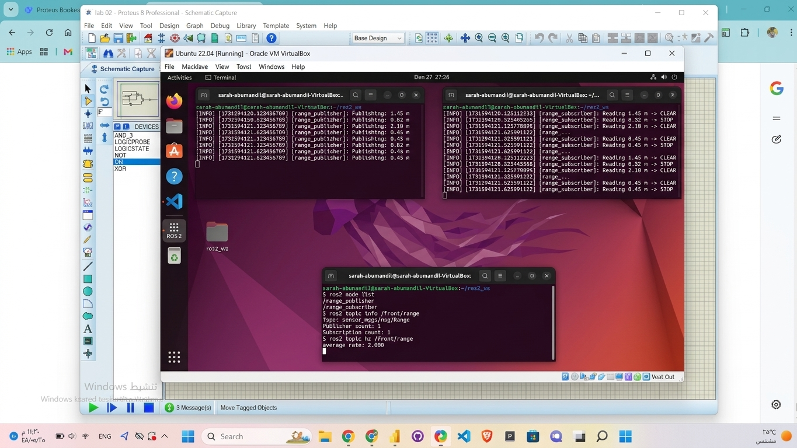

# Assignment 1 : ROS 2 Nodes and Sensor Topics

**student name:** Sarah Abumandill  
**student number:** 220223416
**Email:** sabumandil@gmail.com  
**Course:** DSAI4304 Robotics 
**Package:** `dsai4304_a1_sensor_monitor`

---

## Overview


`dsai4304_a1_sensor_monitor` is a small ROS 2 Python package that simulates a
**front-range sensor** and detects when an obstacle is near.

The package contains **two independent nodes** that communicate only through a
ROS 2 topic:

| Node | Executable | Role |
|------|------------|------|
| Publisher | `publisher` | Publishes distance readings on `/front/range` at **5 Hz** |
| Subscriber | `subscriber` | Listens on `/front/range` and prints **CLEAR** or **STOP** |

### Topic specification

| Property | Value |
|----------|-------|
| Topic | `/front/range` |
| Message type | `std_msgs/msg/Float32` (standard scalar) |
| Unit | **metres (m)** |
| Expected range | **0.00 m – 5.00 m** (simulated: 0.30–0.80 m) |
| Publish rate | **5 Hz** (every 0.2 s) |
| Decision threshold | **0.50 m** |

### Decision logic

- `reading >= 0.50 m` → **CLEAR**
- `reading <  0.50 m` → **STOP**

The publisher cycles through deterministic values that cover **both sides** of
the threshold:

```

0.60 → CLEAR
0.40 → STOP
0.80 → CLEAR
0.30 → STOP
0.50 → CLEAR   (exactly at threshold)

```

---

## Repository structure

```

dsai4304_a1_sensor_monitor/
├── README.md
├── .gitignore
└── src/
└── dsai4304_a1_sensor_monitor/
├── package.xml
├── setup.py
├── setup.cfg
├── resource/
│   └── dsai4304_a1_sensor_monitor
└── dsai4304_a1_sensor_monitor/
├── init.py
├── publisher_node.py
└── subscriber_node.py

```

---

## Requirements

- Ubuntu 20.04 / 22.04 / 24.04 (tested in VirtualBox)
- ROS 2 (Humble / Iron / Jazzy)
- Python 3
- `colcon` (`sudo apt install python3-colcon-common-extensions`)

Check your ROS 2 distribution:

```bash
ls /opt/ros/
```

Use that name wherever you see <distro> below.

---

Installation & Build

Run these commands once from a clean terminal.

```bash
# 1. Source ROS 2
source /opt/ros/<distro>/setup.bash

# 2. Create workspace
mkdir -p ~/ros2_ws/src
cd ~/ros2_ws/src

# 3. Clone this repository
git clone https://github.com/<your-username>/dsai4304_a1_sensor_monitor.git

# 4. Build
cd ~/ros2_ws
colcon build --packages-select dsai4304_a1_sensor_monitor

# 5. Source the workspace
source install/setup.bash
```

Verify the package is visible:

```bash
ros2 pkg list | grep dsai4304
```

Expected: dsai4304_a1_sensor_monitor

---

Running the nodes

You need two terminals.

Terminal 1 — Publisher

```bash
source /opt/ros/<distro>/setup.bash
cd ~/ros2_ws
source install/setup.bash
ros2 run dsai4304_a1_sensor_monitor publisher
```

Expected output:

```
[INFO] [range_publisher]: Publisher started on /front/range at 5 Hz (unit: metres, expected range: 0.00-5.00 m)
[INFO] [range_publisher]: Publishing: 0.60 m
[INFO] [range_publisher]: Publishing: 0.40 m
[INFO] [range_publisher]: Publishing: 0.80 m
[INFO] [range_publisher]: Publishing: 0.30 m
[INFO] [range_publisher]: Publishing: 0.50 m
...
```

Terminal 2 — Subscriber

Open a new terminal:

```bash
source /opt/ros/<distro>/setup.bash
cd ~/ros2_ws
source install/setup.bash
ros2 run dsai4304_a1_sensor_monitor subscriber
```

Expected output:

```
[INFO] [range_subscriber]: Subscriber listening on /front/range (threshold = 0.50 m)
[INFO] [range_subscriber]: Reading 0.60 m -> CLEAR
[INFO] [range_subscriber]: Reading 0.40 m -> STOP
[INFO] [range_subscriber]: Reading 0.80 m -> CLEAR
[INFO] [range_subscriber]: Reading 0.30 m -> STOP
[INFO] [range_subscriber]: Reading 0.50 m -> CLEAR
...
```

If you see CLEAR and STOP, the system works e2e .

---

Verification

Open a third terminal:

```bash
source /opt/ros/<distro>/setup.bash
cd ~/ros2_ws
source install/setup.bash
```

Nodes

```bash
ros2 node list
```

```
/range_publisher
/range_subscriber
```

Topics

```bash
ros2 topic list
```

```
/front/range
```

Topic info

```bash
ros2 topic info /front/range
```

```
Type: std_msgs/msg/Float32
Publisher count: 1
Subscription count: 1
```

Live data

```bash
ros2 topic echo /front/range
```

```
data: 0.6
---
data: 0.4
---
...
```

Publish rate

```bash
ros2 topic hz /front/range
```

```
average rate: 5.0xx
```

Screenshots

Replace these placeholders with real screenshots from your VM.

docs/node_list.png
docs/topic_echo.png
docs/topic_hz.png

---

Concept Questions

**Q1** What does the publisher send and how does the subscriber discover it without calling the publisher directly?

The publisher sends std_msgs/msg/Float32 messages containing a distance value
in metres on the topic /front/range. It does not call the subscriber
directly. ROS 2 uses a publish–subscribe model built on DDS discovery:
when both nodes are running, DDS automatically detects that one node publishes
and another subscribes to the same topic, and it establishes the connection.
The subscriber only needs to know the topic name and the message type —
not the publisher's identity or address. This decoupling means nodes can start
in any order and remain independent.

**Q2** How would changing the publish rate affect the interpretation of a moving obstacle?

The publish rate determines the temporal resolution and latency of the
sensor data. At 5 Hz, a new reading arrives every 0.2 s. If an obstacle
moves faster than the sensor can sample, the subscriber may miss it
entirely or react too late (e.g., a fast object could enter and leave the
0.50 m zone between two samples). A higher rate gives fresher, more
accurate data and faster STOP detection, but costs more bandwidth and CPU. A
lower rate makes the data stale and can cause unsafe or delayed decisions
for a moving obstacle. In short, the rate directly affects how reliably the
system can interpret and react to motion.

**Q3** Name one reason a ROS 2 QoS mismatch can prevent two otherwise compatible nodes from communicating.

A common reason is a reliability QoS mismatch. If the publisher uses
BEST_EFFORT (e.g., a sensor driver that tolerates dropped messages) and the
subscriber requests RELIABLE, DDS will refuse to connect them because the
subscriber demands a guarantee the publisher cannot provide. Both nodes appear
alive, but no data flows. Other mismatches (e.g., durability VOLATILE
vs TRANSIENT_LOCAL, or incompatible history depth) can cause the same silent
failure.

---

Notes on design choices

· std_msgs/msg/Float32 — simplest standard scalar message, no custom
  message definition needed.
· 5 Hz — implemented with create_timer(0.2, ...) (0.2 s period).
· Deterministic values — [0.60, 0.40, 0.80, 0.30, 0.50] cycles forever
  and covers both sides of the threshold plus the exact threshold value.
· >= for CLEAR — matches the assignment wording ("at least 0.50 m").
· Two separate nodes — required by the assignment; they communicate only
  through the topic.
· build/, install/, log/ not committed — generated by colcon build;
  excluded via .gitignore for reproducibility.

---

Reproducibility checklist

☐ ROS 2 sourced (source /opt/ros/<distro>/setup.bash)
☐ Workspace built (colcon build --packages-select dsai4304_a1_sensor_monitor)
☐ Workspace sourced (source install/setup.bash)
☐ Publisher prints Publishing: X.XX m
☐ Subscriber prints both CLEAR and STOP
☐ ros2 node list shows both nodes
☐ ros2 topic hz /front/range shows ~5 Hz

