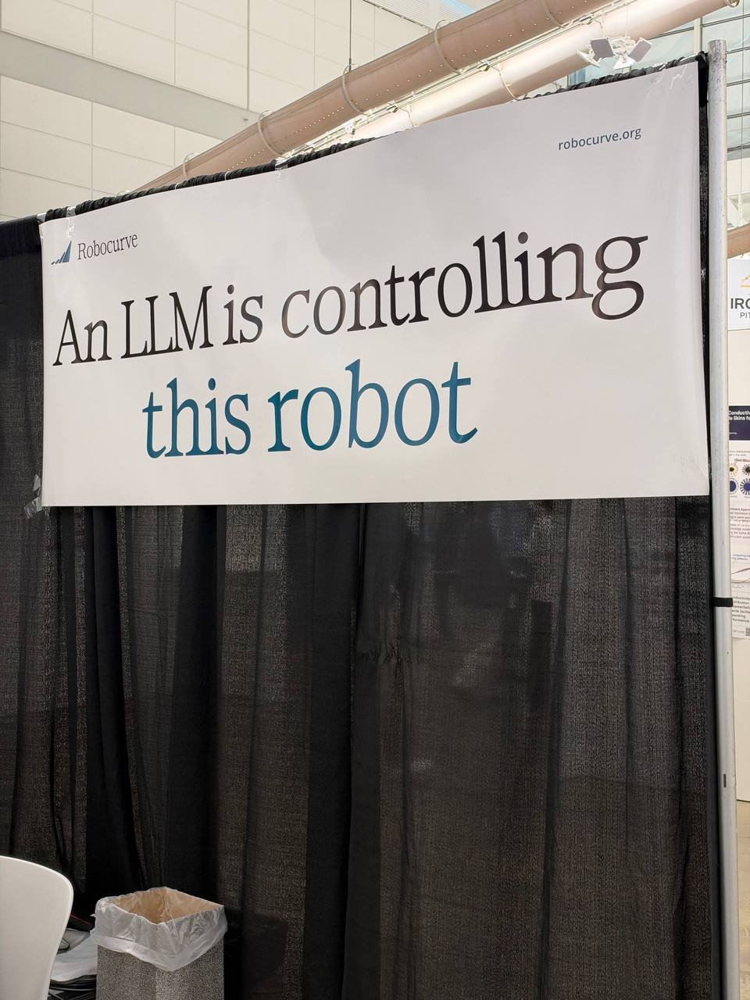
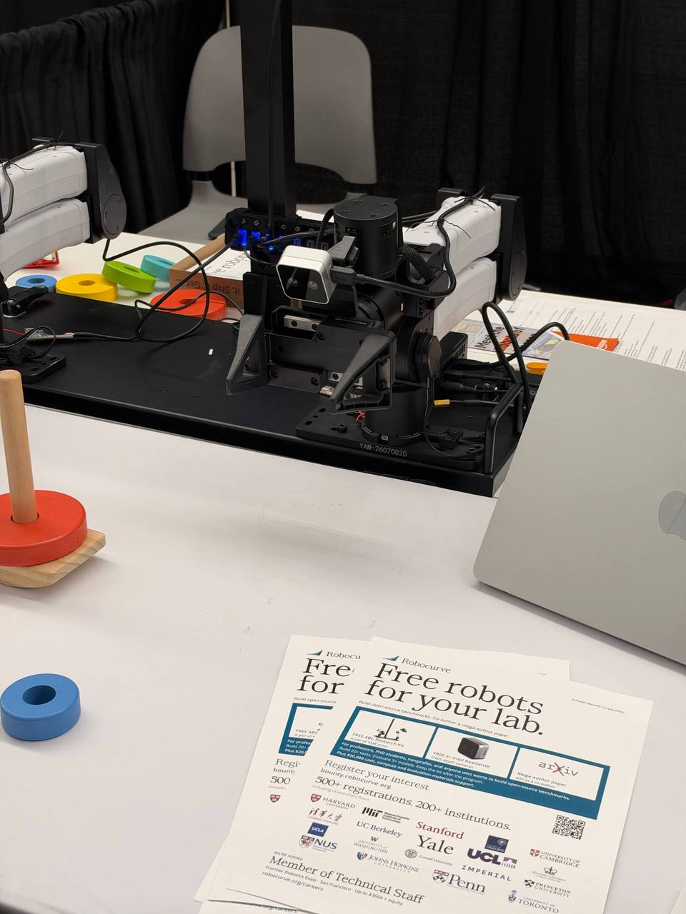
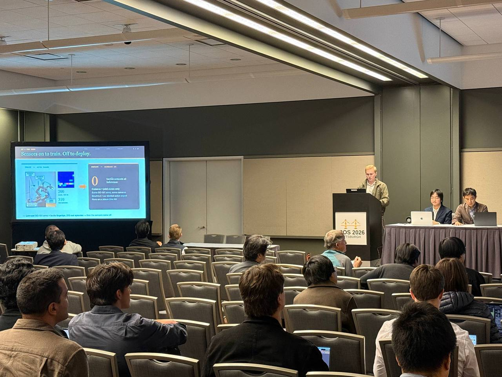
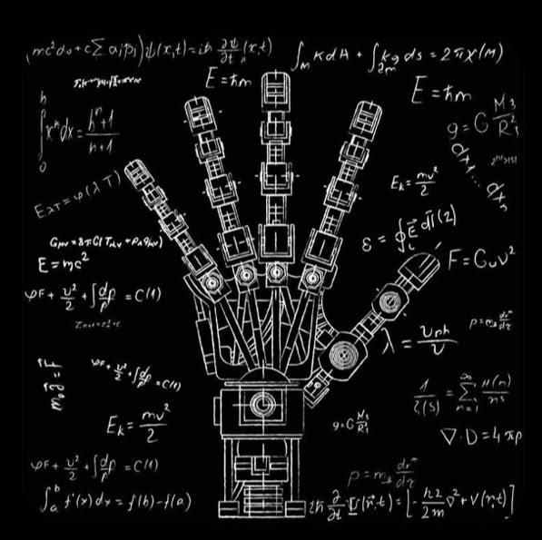
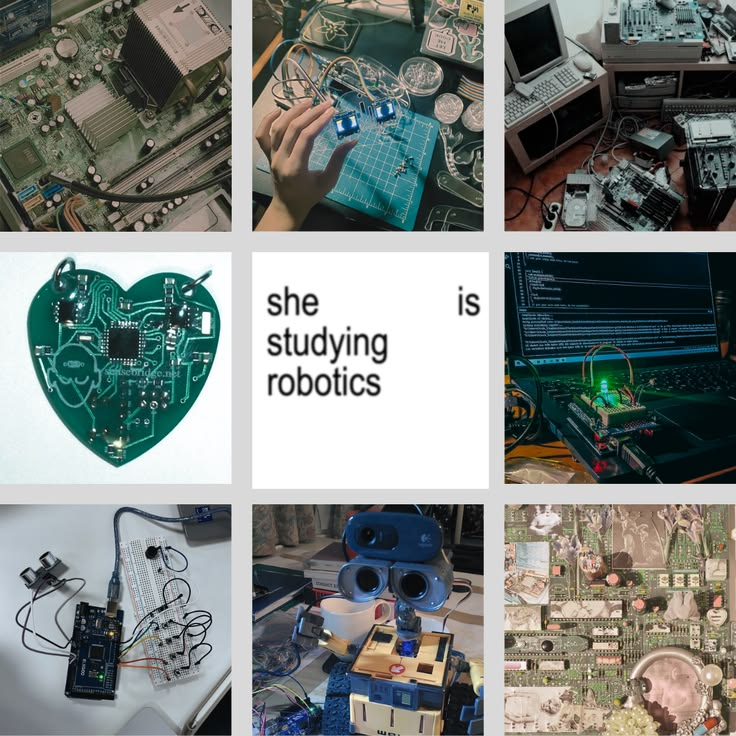
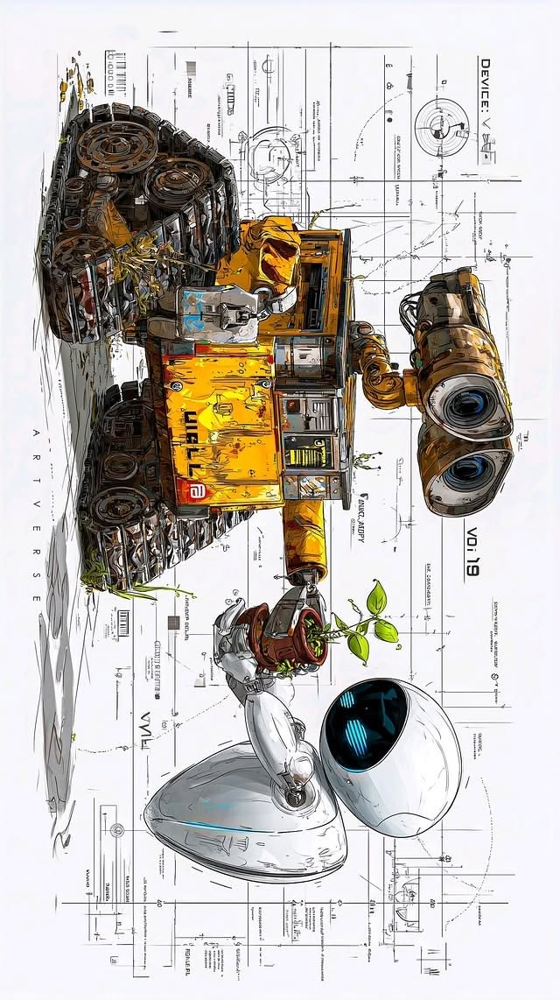

## Visual Gallery

| IROS 2026 | Robocurve Booth | LLM Banner |
| :---: | :---: | :---: |
|  |  |  |
| **Sensors on to train** | **Free robots for your lab** | **An LLM is controlling this robot** |

| Robotics Math | Study Meme | Robotics Art |
| :---: | :---: | :---: |
|  |  |  |
| **The Math Behind It** | **She is studying robotics** | **Art & Future** |
